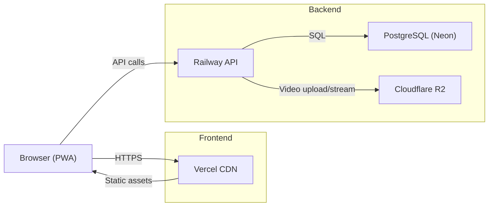

# Architecture Topology

## Services

| Service | Provider | Purpose |
|---------|----------|---------|
| Frontend | Vercel | React SPA, static hosting |
| API | Railway | Express server, auth, business logic |
| Database | Neon PostgreSQL | User data, sessions, intentions, tags |
| Object Storage | Cloudflare R2 | Technique video clips |
| Transcoding | Railway (in-process) | ffmpeg worker for video encoding |
| Push Notifications | Web Push (VAPID) | Class-time reminders |
